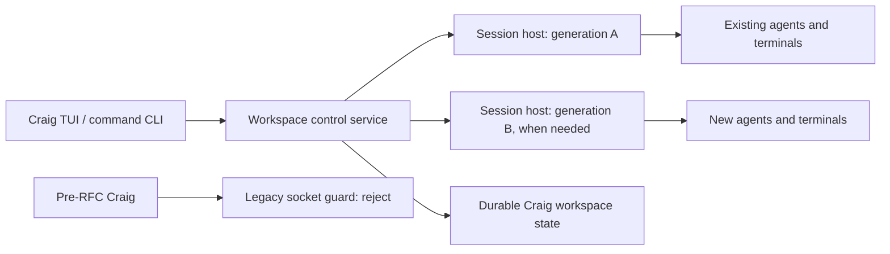

# RFC: Session-Preserving Daemon Upgrades

- **Date:** 2026-11-02
- **Status:** In Flight
- **Author:** Sam / Codex
- **Amends:** [Terminal Workspace Rewrite](2026-05-01-rfc-craig-terminal-workspace-rewrite.md), Phase `3.4`; [Agent CLI Control Plane and Declarative Orchestration](2026-07-27-rfc-agent-cli-orchestration.md), runtime ownership and supervisor lifecycle

## Context and goals

Craig's background daemon survives foreground CLI exits and package updates. A new UI can therefore connect to code from an older installation. Today, `ping` exposes protocol version and session count, but no release/build identity or capability negotiation. `src/shell/pty-daemon-protocol.ts` accepts protocols 6–10, while the activity and navigation clients require the current protocol. A successful connection does not establish that all requested behavior is supported.

The same daemon owns `node-pty` processes, terminal emulators, orchestration, PR polling, and client subscriptions. Its shutdown path calls `disposeAll()`, which kills PTYs. Automatically restarting it after an update would interrupt the very conversations background persistence exists to preserve.

The product requirement is: **updating Craig must preserve the running agent process, its conversation, and its terminal session.** Reopening a saved agent thread in a replacement process does not satisfy that requirement. Persisted runner history is useful recovery, but is separate from live session continuity.

Goals:

- Keep live agents and terminals running across CLI updates and control-service replacement.
- Detect incompatible behavior before using it; give TUI and command clients the same answer.
- Automatically adopt updated control behavior without requiring users to restart their agents.
- Preserve foreground exit/reattach, selected-task launch, and direct new-task launch contracts.
- Upgrade existing workspaces without killing sessions owned by the current monolithic daemon.
- Preserve single-supervisor ownership and existing uncertain-prompt-delivery semantics.

## Non-goals

- In-process module hot reload or transfer of native PTY handles between processes.
- Keeping a process alive through host crash, OS reboot, machine shutdown, or an explicit session termination.
- Exporting agent transcripts, implementing runner-specific conversation resume, or changing agent conversation storage.
- Remote hosting, TCP access, an OS-installed system service, or a separate npm package.
- Making an old binary support future features, or indefinitely supporting every old control protocol.
- Changing Fury product semantics, preview graduation, or durable task/command/event schemas beyond additive runtime references. The task-create admission/recovery record introduced below is the explicit additional durable contract in scope.

## Proposal

### Separate session lifetime from control lifetime

The control service is replaceable. A session host lives as long as its sessions need it. UI exit, control-service disconnect, and an upgrade request never imply session disposal.

| Component | Owns | Lifetime and update rule |
| --- | --- | --- |
| Foreground TUI / CLI | Navigation, presentation, command entry | Runs the invoked installation; reconnects after control replacement |
| Workspace control service | Task orchestration, runner prompt encoding and startup guards, activity interpretation, PR polling, durable-event reconciliation, navigation routing | One active workspace leader; replaces itself at a bounded safe point |
| Workspace compatibility guard | Legacy socket and rejection handshake | Independent process retained across control replacement; prevents pre-RFC clients from starting a competing monolithic daemon |
| Session host | PTY handles, child processes, terminal emulator and scrollback, terminal-query responses, per-session I/O ordering, raw process/output facts | Retained while sessions exist; a host revision change directs new sessions to a new generation |
| Workspace files | Tasks, commands, events, Fury state, runtime discovery records | Durable domain state remains authoritative; runtime discovery is recoverable metadata |

Keep the emulator in the host initially. Reconstructing terminal state from a bounded raw-output buffer after every service restart would lose scrollback, cursor modes, or screen state. The host exposes versioned, UI-independent screen snapshots and deltas. Rendering to terminal-kit stays in the foreground UI. Move runner-specific interpretation out of `PtyRuntime`; the control service derives agent state from process facts, output timestamps, and screen snapshots.

The host does not read config, task files, GitHub state, or orchestration records, and does not decide whether to launch, prune, or cancel work. It executes explicit requests for a concrete session identity. An existing process cannot be replaced by `ensureSession`: attaching to an exited session returns its exit state; launching again requires an explicit new session incarnation.

### Three independent identities

Use separate identities for release display, executable selection, and wire compatibility:

- `craigVersion`: human-readable package version; development builds may have no release version.
- `buildId`: content-derived identity of the built runtime, including its dependency lock/manifest identity. Development invocation derives an identity from the relevant source/config/dependency inputs instead of using the shared string `unknown`.
- Protocol major/minor and named capabilities: separate contracts for client/control and control/host. Release equality alone neither grants compatibility nor demands a session-host restart.

Each host also reports `hostRevision`, a content identity for the host implementation and its runtime dependencies. Ordinary orchestration/UI changes leave this revision unchanged. Compatible hosts can continue accepting new sessions when their revision matches; changed host code uses a new generation for new sessions, even if the wire protocol remains compatible. This lets host fixes take effect without interrupting old sessions.

Compute `hostRevision` from the host's transitive code/dependency inputs, separately from the full CLI bundle hash. Hosts still execute the single published bundle; a UI-only bundle change must not manufacture a host revision change. The tradeoff is intentional: an old session retains its host implementation, including emulator behavior, until it finishes. Updating that code in an already-running session is outside this guarantee.

Maintain an explicit compatibility table and fixture suite for supported protocol majors/capabilities. Additive optional fields use minor/capability evolution. Unsupported operations fail before side effects. Unknown protocol majors fail closed. An adapter may support a known old profile, but a broad version-number allowlist is not sufficient evidence of feature support.

### Update behavior

Craig checks lifecycle state when the TUI opens or a command needs runtime access. Do not depend on npm install hooks. An already-running UI does not silently reload itself; the next invocation from an updated installation triggers reconciliation, and existing compatible clients reconnect to the replacement service.

1. Resolve and validate the canonical workspace endpoint and service identity.
2. Negotiate capabilities before making mutating requests. Read-only status reports availability without starting or upgrading services as a side effect.
3. If the service is current and compatible, connect.
4. If a compatible newer service is running, an older client connects using its supported capabilities. It never requests a downgrade.
5. A newer installed release can request service replacement. Concurrent requests serialize under a workspace lifecycle lock and recheck state after acquiring it. Equal-release but different-build identities are a conflict; development build replacement requires an explicit `craig daemon restart` from the desired checkout, preventing two checkouts from oscillating automatically.
6. Prepare the replacement artifact and verify that it supports every live host and the current durable-state schema before touching the old service. Failure leaves the old service and sessions running, and blocks operations that require newer behavior.
7. The old service atomically closes mutation admission and enters `draining`: reject unadmitted mutations with a retryable upgrade response, finish admitted operations (including complete task provisioning/launch transactions) and runner paste/submit sequences, establish host handoff holds, flush durable state, stop reconciliation/polling, release leadership, and exit without disposing sessions. The independent compatibility guard continues listening. Reads and host output processing can continue until disconnect.
8. Start the replacement from the requesting installation's pinned artifact. It acquires leadership, enumerates hosts, recovers admitted operations, adopts logical view ownership and host handoff holds, reconciles runtime facts, then advertises readiness. Clients resubscribe and fetch full view/activity snapshots before applying further deltas. Release handoff holds only after the replacement or compatible rollback has adopted their retained state.

Normal draining has a five-second deadline. If it cannot finish, abort the automatic upgrade and keep the old service; do not force-kill it or overlap leaders. A hung service can require explicit repair, while the session hosts keep agents alive. If the old service has exited and the new one fails readiness, retry the previous pinned service only if no irreversible state migration occurred and schema compatibility is proven. Otherwise report control-service unavailability and retain all hosts. Durable work resumes when a compatible service starts.

Automatic replacement performs no irreversible durable-schema migration. Mutation admission and the transition to draining use the same serialized control-service gate; a client-side readiness check is not admission. Domain transactions already admitted finish under their existing locks. Continue supporting their on-disk format across the handoff. A future incompatible schema migration needs its own coordinated design and cannot be smuggled into automatic service replacement.

Service replacement is allowed while agents are busy: the safe point concerns service mutations, not completion of an agent turn. Queued commands keep their original deadlines. During an unavailable interval, new automated delivery pauses; agent computation and host output draining continue.

### Task creation is one admitted operation

Today, task creation persists a task/worktree before requesting agent launch, and a failed launch records startup failure. Checking lifecycle readiness before that sequence leaves a race with draining. Move runtime-backed task creation behind a control-service operation that admits the whole sequence before its first provisioning side effect. Foreground and delegated creation use the same path; the service still invokes domain-owned provisioning and lifecycle functions.

The caller allocates a stable `operationId` before submission. Admission durably reserves the task identity, launch creation id, session incarnation, and intended host before provisioning. A domain-owned operation record under `.craig/operations/task-create/` tracks `admitted → provisioning → provisioned → launching → completed`, with explicit `failed` and `recovery_required` outcomes. Bind the id to the validated request and reject reuse with different inputs. Store only recovery fields and a request digest; refer to the existing task record for conversation/task content after provisioning.

The admission remains counted until the result is durably recorded. Draining rejects new operations before provisioning and lets admitted creation finish, including host launch and task-start persistence. A five-second drain timeout reopens admission on the old service without cancelling or restarting the operation. A transient upgrade response or lost response is not an agent startup failure. Callers query/resubmit the same operation id; they do not repeat the high-level create command with a fresh identity.

After a crash, inspect the reserved task/worktree and authoritative host inventory before taking another side effect. Reconcile a launched session to the existing task and complete the original operation. A verified provisioned-but-unlaunched operation can retry only its launch with the original creation/session identity. Incomplete provisioning with an ambiguous filesystem/Git outcome enters `recovery_required` and reports the existing task identity; it must not generate a second task or erase the partial worktree. Real provisioning/agent-start failures remain failures. This adds bounded task-create recovery metadata, not a general workflow engine.

### Host generations and ownership

Hosts have random instance identities, unique sockets, and immutable host revisions. Sessions use `(taskId, tabId, sessionId)`; `sessionId` distinguishes process incarnations. A host owns each session until it exits or the user explicitly closes it. A control restart neither recreates missing sessions nor reassigns live ones.

At the first launch requiring a different host revision, create a new host generation. Existing sessions remain on their old generation, and new sessions use the current generation. One control service routes across both. Never run two hosts for the same session identity. `ensureSession` requests carry a stable creation id; the host deduplicates them, and a control crash after spawn is recovered by enumerating hosts before attempting another launch.

An old host retires only when it has no live child processes, logical view leases, pending creation operations, or handoff holds. Preserve exited views while logically retained; do not erase visible scrollback during an update. Host shutdown is an atomic `shutdownIfUnused` operation that checks all four conditions under the same serialization as creation and view ownership changes. A stale client count, agent `ready` state, or an unverified registry cannot authorize shutdown.

Each view has an opaque `viewId` and host-issued ownership token, independent of the service socket. The foreground saves its view identity in local shell state before acknowledging attachment. Hosts retain these logical leases when a socket disconnects, the control service dies, or the agent exits. Clients reconnect using the same identity and fetch the retained screen/scrollback. A deliberate view detach/close sends an idempotent release for that view; explicit task/tab closure releases all its views as part of the intentional session-close operation. One client's release cannot remove another client's view.

Before planned replacement, acquire an idempotent handoff hold on every retained host, keyed by the upgrade transaction. The replacement adopts these holds and leases before readiness; it releases holds only after inventory/view recovery is complete. Controller takeover after an unplanned crash acquires recovery holds before reconciliation, while existing logical leases independently preserve exited views. No lease or hold expires merely because a heartbeat or reconnect timeout elapsed. An unreachable client or failed replacement can therefore retain a host longer; report the reason in status, and allow deliberate closure through existing task/tab controls. Acknowledgement loss conservatively retains state. Host crashes remain outside the continuity guarantee.

The replacement service must support every retained host. If a future release cannot, refuse automatic service replacement and retain the last compatible runtime. An unsupported host is not permission to kill its sessions. Shipping a host-major change therefore requires an adapter for still-supported live generations or an explicit documented upgrade block.

### Existing daemon migration

There is no implemented way to move today's daemon-owned PTYs to another process. Treat it as a legacy runtime whose sessions must finish in place.

- Probe the existing socket non-destructively and use explicit legacy protocol profiles. Metadata added by this RFC helps later releases; it is not assumed present in pre-RFC binaries.
- While any legacy session exists, retain that daemon. Compatible attach/input remain available. Unsupported new features return an actionable upgrade-pending result instead of attempting an unknown request.
- Do not start a competing orchestration service or route new sessions into the new topology while the legacy runtime remains authoritative. Compatible legacy task creation remains possible, with a notice that it delays migration. Do not allow newer command/config/state mutations that the known legacy profile cannot consume safely.
- Existing daemons cannot atomically freeze creation, prove absence of background work, or retire themselves conditionally. Therefore never automatically send their unconditional `shutdown`, even when a ping reports zero sessions. Offer explicit migration only after all sessions finish, pending orchestration is resolved, and all old Craig clients are closed; explain that other clients must remain closed during this one-time transition. Unknown/unverifiable inventory blocks migration. A daemon already gone permits normal stale-endpoint recovery.
- A daemon built with the lifecycle-aware bridge can atomically enter a drain that rejects session creation, finish service work, prove an empty inventory, and exit voluntarily. Future upgrades use that safe path.

This first migration can remain pending indefinitely if a user keeps a legacy conversation alive. It must never turn into an automatic destructive restart. The UI reports this limitation plainly: “Existing sessions are preserved on the previous runtime. Some updated features will be available after those sessions finish.”

### Prevent a legacy binary from starting a second runtime

Pre-RFC binaries do not inspect `control.json`, honor the new lifecycle lock, or negotiate the new protocol. If their old socket is absent, their launcher can spawn a monolithic daemon. New-runtime discovery alone cannot prevent this.

Once a workspace transitions, a small independent compatibility-guard process owns the original socket and PID path. Its `ping` returns a successful response with reserved incompatible `protocolVersion: 0`; it rejects every mutation, including legacy `shutdown`, with instructions to use an updated Craig binary. This makes known pre-RFC TUI and delegated launch paths detect an incompatible live owner and refuse to spawn. Do not proxy legacy writes or `pruneStale` into the split runtime: those requests lack session incarnation and admission guarantees. Older clients that implement this RFC may negotiate with the new service; pre-RFC clients are explicitly rejected.

Start the guard from a pinned artifact before advertising the split runtime or launching its first session. Retain its listener throughout control draining, replacement, rollback, and host retirement. It exits only after an explicit workspace-runtime shutdown verifies there are no control services, hosts, pending creates, or retained views; an empty host inventory during a service handoff is insufficient. Its PID record identifies the guard, and its own protocol supports authenticated status and orderly shutdown by the new lifecycle manager, separate from rejected legacy requests.

For legacy migration, wait for the old owner to exit under the migration rules, bind the guard without unlinking any live listener, then publish the new topology. If an old launcher wins the bind race, preserve that daemon and abort the transition. The initial transition retains the requirement that all pre-RFC clients be closed: already-starting old binaries do not honor new locks and may unlink the old socket themselves. Do not claim race-free coexistence with such a startup in progress. Test pre-RFC invocations after guard readiness, plus detection/abort of a competing legacy startup during migration.

The guard is an additional small resident process whose lifetime is independent of service upgrades. Its failure is a loss of the legacy-launch exclusion boundary: report it, repair it before new runtime mutations, and do not claim exclusion during an arbitrary guard crash. Already-running hosts continue preserving their sessions. No new npm package or OS service is introduced.

### User-facing controls

- `craig daemon status [--json]`: read-only service/build/protocol/capability state, host generations, active and retained session counts, upgrade state, and reason for a blocked upgrade. No auto-start or replacement.
- `craig daemon restart [--json]`: replace only the control service while preserving hosts. On a legacy monolith, refuse while sessions or work exist and explain the one-time migration conditions; an explicit empty legacy migration uses a separate `--migrate-legacy` acknowledgement of those conditions.
- Existing task/tab close and cancellation commands remain the way to intentionally terminate agents. A service restart never implies those actions. Keep the current internal unconditional shutdown entrypoint out of the new upgrade path and audit its callers.
- The TUI shows a concise updating, reconnecting, or upgrade-pending message. A transient service disconnect is “reconnecting,” not evidence that every agent failed or became idle. Full snapshot reconciliation distinguishes a real process exit.

Automatic reconnection retries reads and subscriptions, but never blindly replays writes, task creation, or prompt submission. While disconnected, keyboard input is paused with a visible message rather than queued for later replay. A request whose acknowledgement was lost is reported as uncertain unless its stable creation/command identity can prove the outcome.

## Implementation tracker

### Status summary

- `1.1` Unified lifecycle negotiation and legacy protection: `implemented and verified` (`2026-11-13`). Shared shell resolver/profiles and domain status, content build identities, read-only `daemon status`, upgrade-pending diagnostics, mutation preflights, non-destructive empty drain, and identity-conditional owner cleanup are delivered. Inventory-only pruning no longer terminates sessions. Includes a `craig-cli` minor Changeset for the additive stable status command.
- `2.1` Independent session hosts, guarded legacy transition, admitted task creation, and retained views: `implemented and verified` (`2026-11-13`). New-workspace hosts own raw PTYs/emulators independently of replaceable control, pinned dependency closures and the resident protocol-0 guard. Foreground/delegated creates have durable admission/recovery; logical views survive transport/control loss and agent exit. Includes a `craig-cli` minor Changeset for stable task-create operation identities.
- `3.1` Session-preserving control-service replacement: `implemented and verified` (`2026-11-13`). Newer stable releases reconcile automatically under lifecycle ownership; explicit `daemon restart` selects equal-release/development builds without downgrading. Read-only candidate preflight, bounded shared admission/draining, authenticated prepare/commit/abort, pinned compatible rollback, retained handoff holds, and non-replaying foreground reconnection are delivered. Includes a `craig-cli` minor Changeset for the stable restart command.
- `4.1` Host revision rollover and packaged-update acceptance: `not implemented`.
- No phases are skipped or deferred. Runner-specific crash recovery and OS service installation are out of scope.

### Verification summary

- `2026-11-02`: Design grounded in the existing daemon, PTY runtime, build script, activity/navigation clients, orchestration leader, and prompt-delivery flow. No implementation or runtime verification has occurred.
- `2026-11-02`: Review refinement specifies a resident legacy-endpoint guard, atomic admission and recovery for task creation, and logical view leases plus host handoff holds. Corresponding race tests and phase acceptance criteria are required below; these are design changes, not verified runtime fixes.
- `2026-11-13`: Verified the frozen brief SHA-256 `a9cb92100983d6e1b105d3ca76cf766f60f1da67fc476cf74b462f6fc970eb08` before copying it unchanged into this child worktree; only tracker/checklist edits followed. Inspected planning checkout `a2a1fbcd146898bc46c396ae957942d6c3041b9a` against fresh child baseline `83f0f675fd6487021e0ba0b4cfab9d2a2d5e0e0a`, preserving the newer Fury, capability-refresh, and launcher behavior.
- `2026-11-13`: `tests/runtime-lifecycle.test.ts` passes all 15 cases: profiles 6–10 across TUI/activity/navigation/delegated clients; absent metadata and explicit capability rejection; old/new releases and equal-version development build conflicts; read-only status with agent context; live/unresponsive owners; PID, symlink, dead-lock and replacement-token checks; zero-session legacy rejection; non-destructive drain with retained sessions; and the concurrent empty-drain/create admission race. Protocol 6 does not grant orchestration, protocols before 8 do not grant PR polling, and protocols before 10 do not grant navigation. Unknown or malformed profiles fail closed. Legacy Fury support without explicit capability metadata is unproven and newer Fury mutations are blocked before durable writes.
- `2026-11-13`: Frozen pre-RFC TUI and delegated launch functions from the planning checkout independently reject successful protocol-0 pings before spawn/shutdown/cleanup, without importing the new resolver. The unchanged pre-RFC daemon source fixture has SHA-256 `06709776f5a0c6b6269f16c97232ada45c8fa2521b4159f971d4f903d5843869`. The guard itself remains phase `2.1` work.
- `2026-11-13`: Real-process legacy continuity evidence: before and after updated-client connection and blocked upgrade, agent PID `73582`, start nonce `aca56a76-4a9e-4bb9-a365-72c94c0c4d7a`, cwd `/private/var/folders/lq/_19l1s_n0q57q84xpk3dj6g00000gn/T/craig-live-legacy-ma3vVt`, and PTY device/inode `268435471/6907` were identical. The already-running agent successfully recalled state held only in its memory. Its final output and earlier scrollback remained readable after another disconnect/reattach. No runner resume, state-file restoration, or agent relaunch was used. Fixture-owned processes were cleaned up; the live parent workspace daemon was never stopped, signalled, restarted, upgraded, or unlinked.
- `2026-11-13`: Final release gates all pass: `pnpm test` (71 files, 854 tests), `pnpm typecheck`, `pnpm lint`, `pnpm build`, `pnpm build:npm`, `pnpm package:audit`, and `pnpm package:smoke`. Both selected-task agent launch in its worktree and direct new-task agent entry remain covered by the real-terminal E2E suite and app-shell harness. npm output remains one minified bundle, without source maps, under the existing strict allowlist.
- `2026-11-13`: Setup/tuning failures were resolved, not counted as passing evidence: the child initially lacked local dependencies, so the npm build could not resolve its YAML alias; `pnpm install --frozen-lockfile` fixed that environment. A concurrent bootstrap timing failure was fixed by preserving the launcher grace period. The expanded fixture identity required a wider terminal to avoid wrapped JSON. No unresolved baseline or acceptance failures remain in the final run.
- Phase `1.1` historical limits: phase `1.1` preserves the existing monolithic owner and can leave migration pending indefinitely. The real-process fixture bundles the frozen daemon source against current PTY dependencies; it does not prove removal of an old npm installation, split-host/control replacement, guard deployment, or a real supported-agent manual update. Those remain explicitly unverified phase `2.1`–`4.1` acceptance items. Task-create preflights are not atomic provisioning admission; phase `2.1` still owns that durable operation contract.
- `2026-11-13`, phase `2.1`: `tests/session-host.test.ts` verifies explicit incarnation/creation identities, exited-session deduplication, bounded slow-subscriber disconnection while native output drains, authoritative resnapshots, actual lost spawn/write acknowledgements without duplicate process/input, independent logical leases, idempotent release, cross-client ownership, creation reservations, living-controller exclusion, and atomic adoption of a dead controller's bootstrap hold. Host/emulator implementation and terminal types now live under `src/shell/runtime/`, without UI imports. Orchestration awaits confirmed paste and submit after durable delivery admission.
- `2026-11-13`, phase `2.1`: `tests/split-runtime.test.ts` kills only a disposable control process during a live stub-agent conversation. Control PID `34464` becomes `35713`; host PID `34282` and agent PID `35019` remain unchanged. The agent's in-memory turn state, nonce `caa20f1f-df3b-4f81-8f50-3cfa6627f291`, cwd `/private/var/folders/lq/_19l1s_n0q57q84xpk3dj6g00000gn/T/craig-split-runtime-NR7JsS`, and PTY device/inode `140755451/7775` survive, with persisted view `fixture-view:9f35399a-6549-4875-94ed-dd51dfb74c72`. A separate agent exits during control loss: host PID `40818`, agent PID `41173`, nonce `2ff2a475-2e9a-49c5-8347-67961b44d50b`, and PTY `140755451/7803` identify the retained final output and scrollback after control `41033` becomes `42084`. No runner resume/relaunch or transcript restoration is used. Missing host discovery blocks recreation; restored discovery and absent route-cache files recover from authoritative inventory. Concurrent foreground clients target separate sessions; deliberate closure releases only the chosen session. Guard repair preserves a living host/control. Activity disconnect never manufactures agent failure.
- `2026-11-13`, phase `2.1`: `tests/task-create-recovery.test.ts` crashes real isolated control processes after durable admission, during partial provisioning, after provisioning, after spawn before the create acknowledgement, after task-start persistence, and after completed-result persistence. Inspect/resubmit retains the original operation/task/tab/creation/session identities, one worktree and one agent process, correct task/workspace agent environment, and one child initial prompt. Ambiguous filesystem/Git provisioning reports `recovery_required` and preserves partial work. Child-key replay under another operation id returns the original task, mismatched requests fail, and reservations beyond daily sequence 99 remain unique. Completed creates retain an ownership-token-backed view before replying. Both real-terminal launcher contracts pass, including direct newly admitted task entry without an extra attach step; the app-shell contract also remains intact.
- `2026-11-13`, phase `2.1`: `tests/legacy-packaged-runtime.test.ts` archives planning commit `a2a1fbcd146898bc46c396ae957942d6c3041b9a`, builds its normal minified npm artifact, runs `npm pack --ignore-scripts`, extracts it with its dependency closure, and invokes that actual pre-RFC TUI and delegated CLI against the guard both after migration and during control downtime. Protocol-0 rejection prevents old monolithic startup/duplicate agents; shutdown/prune never reach hosts. A legacy owner winning the initial bind aborts split bootstrap. Active sessions, retained exited sessions, and background Fury human-review work block migration; pre-RFC empty migration needs closed-client acknowledgement, while the lifecycle-aware empty bridge drains safely. Existing phase `1.1` tests retain concurrent drain/create, unknown/missing compatibility metadata, and unresponsive-owner coverage. Existing legacy conversations are never automatically replaced.
- `2026-11-13`, phase `2.1`: `tests/runtime-artifact.test.ts` starts the built npm bundle from disposable installation A, pins the complete private bundle and recursively materialized production dependency closure, removes A, verifies every manifest entry and internal dependency link, and continues the same agent's in-memory conversation. A fresh native PTY after removal exercises lazy helper resolution; the verified closure includes `node-pty/build/Release/pty.node`, headless terminal and terminal-kit dependencies. Artifacts validate content, owner, Node executable/ABI and platform; external pnpm dependency links are materialized. This installation-removal acceptance is verified now, not deferred to phase `4.1`.
- `2026-11-13`, phase `2.1`: Final release gates pass: `pnpm test` (76 files, 880 tests), `pnpm typecheck`, `pnpm lint`, `pnpm build`, `pnpm build:npm`, `pnpm package:audit`, and `pnpm package:smoke`. The npm artifact remains one minified bundle without source maps and the package files allowlist is unchanged. Final logs: `/tmp/craig-phase21-verified-{test,typecheck,lint,build,bundle,audit,smoke}.log`. Earlier bootstrap socket-length, endpoint-discovery timing, fixture PID/cleanup, capability-refresh, and admitted-launcher sizing failures were resolved during tuning; no unresolved final-gate or unrelated baseline failures remain. All crash, migration, guard, and package tests use isolated disposable workspace/socket/cache contexts and clean only proven fixture processes. The live parent workspace daemon was never stopped, signalled, restarted, upgraded, or unlinked.
- Phase `2.1` historical limits: new workspaces use a single immutable host generation; automatic distinct-build control replacement/reconnect, public `daemon restart`/migration acknowledgement, multi-generation host rollover, artifact garbage collection, and the manual supported-agent update smoke test remain phases `3.1`–`4.1`. Recovery starts the existing pinned control artifact; this phase does not automatically upgrade it. Legacy monoliths may retain conversations indefinitely, and unknown/live/unresponsive owners block mutation or migration. Ambiguous partial provisioning requires inspection rather than automatic rerun/cleanup. Artifacts and operation/lease tombstones are retained conservatively; no timer alone retires a host.
- `2026-11-13`, phase `3.1`: `tests/control-replacement.test.ts` builds two isolated minified executables with release identities `0.21.0`/`fixture-a` and `0.22.0`/`fixture-b`, with complete materialized production dependencies. Two concurrent newer-release bootstrap invocations produce one replacement; an already attached client renegotiates and resubscribes automatically. Actual continuity evidence: control PID `96984` becomes `98884`, while host PID `96850`, agent PID `97378`, nonce `ebec83ee-b9ba-4a47-9c1a-3beeedfcda00`, cwd `/private/var/folders/lq/_19l1s_n0q57q84xpk3dj6g00000gn/T/craig-control-upgrade-In8n7V`, and PTY device/inode `140755451/8887` stay identical. The same busy stub agent keeps emitting output and advances its in-memory turn counter from `10` to `180`; its next conversational input recalls the retained in-memory state. No resume/relaunch or transcript restoration is used.
- `2026-11-13`, phase `3.1`: The replacement suite verifies read-only status from the newer executable leaves A running, old compatible runtime invocations never downgrade B, equal-release build conflicts require explicit restart, and the public `daemon restart --json` command selects the requested executable. Semver tests include prerelease ordering and build metadata. Candidate preflight verifies canonical workspace identity, client capabilities, every live host protocol, and version-1 task-create/prompt/Fury durable records before closing admission; malformed future operation/discovery records and an actual unsupported host-protocol responder block before old control exits. A blocked automatic preparation retains compatible old terminal access. Wrong lifecycle credentials and competing transaction prepare/abort requests cannot reopen another transaction's drain.
- `2026-11-13`, phase `3.1`: A deliberately failing candidate executable passes read-only preflight but exits during real control startup; the previous compatible pinned executable regains leadership without replacing the host or agent. Fault injection after old-control exit verifies recovery of the persisted interrupted-manager transaction under the lifecycle lock. A living or unresponsive owner is never signalled or replaced on timeout; rollback requires dead target ownership and compatible unchanged durable schemas. The old supervisor owner PID and polling work finish before the replacement becomes authoritative.
- `2026-11-13`, phase `3.1`: A single service admission gate counts whole task creates, foreground/CLI domain mutation leases, async supervisor delivery/capability work, polling and event reconciliation. `tests/task-create-recovery.test.ts` pauses real isolated controls after create admission and after provisioning: drain either completes the original launch and durable result, or times out within the five-second drain budget and reopens old admission without cancelling that create. Rejected unadmitted creates have no operation/task/worktree side effects; original-id retry resolves the same completed task with one PTY and no upgrade-induced startup failure. Admitted task/tab closure carries its token through confirmed runtime disposal during draining; unknown tokens fail rather than bypassing the gate. `tests/runtime-admission.test.ts` proves draining waits for async PR sync and the next owner does not overlap it.
- `2026-11-13`, phase `3.1`: Async supervisor faults before paste, between paste/submit, and after submit-before-ack preserve the durable command identity/deadline and produce `PROMPT_DELIVERY_UNCERTAIN`, without duplicate writes or false initial-agent failure. The replacement leader cannot start while the old lease is held. Existing native host tests independently verify real lost spawn/write acknowledgements without duplicate process/input. Foreground tests prove visible input pause through the control gap, no queued-key replay, and visible uncertainty after a five-second missing input acknowledgement; reconnection retries snapshots/subscriptions and existing attachment, never `ensure` or writes.
- `2026-11-13`, phase `3.1`: Both success and failed-readiness/rollback fixtures drop all foreground/control sockets and let an agent exit after old-control release but before new readiness. The independent guard remains reachable with protocol `0`; host handoff holds and logical view identities retain final output and earlier scrollback. Replacement or rollback adopts the retained host state before readiness/releasing the transaction hold. No heartbeat/timer retires a host or view. The phase `2.1` real old packaged-binary rejection and installation-removal/dependency-closure acceptance tests continue to pass.
- `2026-11-13`, phase `3.1`: Final release gates pass: `pnpm test` (78 files, 901 tests), `pnpm typecheck`, `pnpm lint`, `pnpm build`, `pnpm build:npm`, `pnpm package:audit`, and `pnpm package:smoke`. Both terminal launcher contracts and the explicit app-shell create/attach contract pass. npm output remains one minified bundle without maps under the unchanged package allowlist. Logs: `/tmp/craig-phase31-final-verified-{test,typecheck,lint,build,bundle,audit,smoke}.log`. Frozen brief SHA-256 and the immutable plan outside tracker/checklist edits were reverified.
- `2026-11-13`, phase `3.1`: Tuning failures were resolved, not counted as passing evidence: an extra legacy capability-refresh probe regressed protocols 6–10 and was restricted to replacement-capable controls; a pre-reply view event could override an explicit scroll snapshot and is now covered by a deterministic ordering regression; fixture teardown could observe a dying process before `ps` reported its exit, so it now waits without ever signalling changed/ambiguous identity. Initial compile/test-harness errors were corrected. No unresolved final-gate or unrelated baseline failures remain. Every crash/guard/migration/update fixture used explicit disposable workspace/socket/cache context and cleaned only proven fixture-owned processes. The live parent daemon was never stopped, signalled, restarted, upgraded, or unlinked; no push or PR was created.
- Current limits: phase `4.1` remains unimplemented. New creations still use one immutable host generation; multi-generation routing/retirement, cross-workspace artifact GC, distinct A/B npm-install replacement plus host rollover, and the manual real-supported-agent update smoke test remain its acceptance work. Phase `3.1` A/B fixtures are separately built minified executables with generated release identities, not historical registry installations. Automatic upgrades require a newer stable release; equal-release/development builds need explicit restart, and older releases never downgrade. Legacy monoliths and controls lacking a safe drain contract remain authoritative; ambiguous/live/unresponsive owners or unfinished admitted mutations block replacement rather than being forced out. Abandoned logical views, holds, and operation tombstones are retained conservatively.
- Phases `1.1`, `2.1`, and `3.1` are verified; phase `4.1` remains unimplemented and unverified.

### Next resume point

Resume at `4.1` only when explicitly assigned. Phases `1.1`–`3.1` are implemented and verified; no phase `4.1` implementation is included. Next route new session creations by immutable host revision while retaining existing generations, implement safe cross-workspace artifact retention/cleanup and older-host adapters, and verify host retirement against creates, leases, and hold adoption. Run actual distinct A/B npm installation replacement/removal, new-host and old-host interaction, repeated control replacement, every release gate, and the manual real-supported-agent update conversation before marking `4.1` complete. Preserve the resident guard, same-process continuity, durable admission identities, and no-forced-owner-replacement boundary. Update status, verification, and next resume point together.

## API and data model changes

### Runtime contracts

Create shell-owned runtime contracts under `src/shell/runtime/`; move session-host implementation out of `src/ui/pty/`. Domain-owned runtime status/result types belong in the owning domain, including a new domain runtime module if lifecycle commands require it. Neither the host nor domain may import UI state, terminal rendering, or command types. Preserve `input/ → shell/ → domain/` dependencies.

`hello` returns role, workspace identity, instance id, PID/start identity, Craig version, build id, host revision when applicable, protocol range, capabilities, lifecycle state, and inventory revision. Client requests identify required capabilities. Legacy `ping` remains a probe handled by an adapter, not the current contract.

Host operations cover enumerate, ensure a specific creation id, attach/snapshot, subscribe to view/process facts, targeted input/resize, explicit dispose, and shutdown-if-unused. Every mutation names a session id, avoiding foreground-selected-target state in the host. Mutations are serialized per session; frame size, output buffering, and subscriber queues are bounded. A slow client is disconnected and resynchronizes from a full snapshot; it never blocks PTY output draining.

Add host operations to acquire/resume/release logical view leases and acquire/adopt/release handoff holds. View requests carry `sessionId`, `viewId`, and their ownership token; hold requests carry controller and upgrade-transaction identities. Socket closure only removes transport subscriptions. Control task-create operations expose submit and inspect-by-operation-id, persist admission before provisioning, and return the original task/session identity on retry. Preserve these operation records until explicit safe retention cleanup; an unknown id must not silently become a second create after a recorded operation has expired.

Snapshot subscription establishes a baseline revision and ordered subsequent deltas atomically. Reconnection fetches a fresh snapshot; deltas from another host instance or revision baseline are discarded. PTY output continues updating the host's terminal while no service is attached. Existing scrollback bounds still apply.

Convert `OrchestrationDeliveryRuntime` from synchronous in-process calls to an asynchronous host adapter. Await confirmed paste before the timed submit; await the submit acknowledgement before marking delivery complete. Preserve durable `beginDelivery` before any write. A crash or ambiguous acknowledgement leaves `delivering` to become `PROMPT_DELIVERY_UNCERTAIN`, with no automatic replay. Planned draining waits for the complete delivery sequence.

The lifecycle lock and orchestration leadership are separate. Service instances use identity-bearing ownership records; release and stale cleanup are conditional on the record still belonging to that instance. The old service must release leadership or be proven dead before a replacement reconciles or delivers. Hosts accept automation mutations only from the authenticated active controller; changing that controller requires the previous service to release or be proven dead. Never take over a merely slow but living controller based on heartbeat expiry. Existing leases must be upgraded accordingly.

### Local discovery and pinned artifacts

- `.craig/runtime/control.json`: atomic control instance/build/endpoint/readiness record.
- `.craig/runtime/hosts/<instance-id>.json`: atomic discovery records with host revision, endpoint, PID/start identity and pinned-artifact reference. Inventory from a verified live host is authoritative over cached session routing.
- `.craig/runtime/lifecycle.lock/`: serialized startup/upgrade coordination with owner identity and conservative stale-owner recovery.
- New sockets live in a user-private temporary directory, with workspace hash and instance id keeping paths short. Before migration, probe the original endpoint non-destructively; after migration, its independent compatibility guard continuously rejects pre-RFC clients. Never unlink a live listener as a new-host startup shortcut.
- `.craig/runtime/guard.json`: verified guard instance, endpoint, PID/start identity, and pinned-artifact reference; the legacy PID path also points to this process for old launchers.
- `.craig/operations/task-create/<operation-id>.json`: domain-owned durable admission/recovery metadata and result; survives control replacement. Keep an idempotency tombstone if completed detail is compacted, so old operation ids cannot create fresh tasks.
- Private immutable runtime artifacts live under Craig's per-user cache, keyed by build/platform/Node ABI. Pin the minified CLI bundle and its production dependency closure, including native `node-pty`, independently of the mutable npm installation. Materialize dependencies without dangling links back into npm/pnpm installations, write a content manifest, verify completeness, and atomically publish the cache entry before launch. Record the Node executable/ABI and validate it before a new launch; replacement of the Node installation itself is not covered by CLI upgrade continuity.

The single published package remains `craig-cli`, with the existing strict files allowlist. Hidden process modes in the same bundle launch control and host roles from the private artifact. Do not add platform packages, published runtime directories, or download/execute another runtime. Development artifacts use the same ownership and pinning rules.

Cache cleanup requires a per-user cache lock shared with artifact creation and runtime launch, plus verified references from all live processes across workspaces. Unknown liveness retains artifacts. Keep the previous compatible control artifact for rollback; never delete an artifact used by a live host. Do not serialize prompts or environment values into artifact manifests.

Durable task/tab identifiers remain unchanged. Runtime records add session incarnation and host references without rewriting conversation metadata. Never infer that a tab must be relaunched just because a host record is missing; first rediscover verified endpoints, otherwise report runtime unavailability.

## Edge cases and failure modes

| Situation | Required behavior |
| --- | --- |
| Two updated clients start together | One lifecycle owner starts/replaces the service; other clients observe readiness and attach; no duplicate PTYs |
| Old and new clients coexist | Negotiate individually; no automatic downgrade or repeated replacement; unsupported client operations fail before mutation |
| Pre-RFC binary opens after migration | Independent legacy listener returns incompatible protocol; old launch paths refuse to start a second daemon |
| Task provisioning overlaps draining | Admission covers provisioning through launch; finish it or abort the upgrade, without manufacturing startup failure |
| Agent exits during control handoff | Logical view leases and handoff holds retain its final screen and scrollback until adopted or explicitly released |
| Service dies during agent work | Hosts continue output draining and keep child PIDs; reconnect without relaunch |
| Service dies between paste and submit | Preserve process, fail the command as uncertain, do not resubmit |
| Host revision changes | New sessions use the new generation; existing sessions stay with their owner |
| Host is alive but unresponsive | Preserve endpoint and process; report blocked/unavailable; never unlink or kill based on a timeout |
| Host actually dies | Report genuine session loss; do not claim conversation continuity or silently launch a replacement |
| PID reused / stale socket or lock | Verify instance/start identity and ownership before cleanup; ambiguity blocks mutation |
| Task list is stale or temporarily unreadable | No destructive bulk pruning; explicit close/cancel or verified authoritative reconciliation required |
| Update occurs with no foreground UI | Existing runtime continues; next runtime-requiring invocation reconciles the update |
| npm installation is removed or replaced | Running and pinned runtimes remain usable; packaged-update test proves dependency independence |
| New service cannot read old durable state | Leave old service active; report incompatibility before changing records |
| Ctrl-C, SIGTERM, or UI detach | Foreground exits detach; control termination stops control only; host termination is a distinct explicit operation |

During control downtime, elapsed-time deadlines continue to advance; replacement reconciliation applies expiration once it regains leadership. It must not mark agents unavailable from an incomplete host snapshot or manufacture durable agent-failure events from a transport disconnect.

## Security and privacy

Use local Unix sockets with owner-only directories (`0700`) and records/credentials (`0600`). Authenticate controller registration using a local runtime credential; reject other workspaces, stale instances, malformed requests, and oversized frames. Check filesystem ownership and reject unexpected symlinks during discovery, cache publication, and cleanup. Same-user processes with full filesystem access are not a security isolation boundary.

Raw input, prompts, terminal contents, credentials, and environment values do not appear in lifecycle logs or status output. Terminal buffers stay in host memory with existing bounds. Status exposes identifiers and counts needed for diagnosis, not conversation text. Runtime files and private cached artifacts are never included in npm output.

## Observability

Log structured `runtime.discovered`, `compatibility.rejected`, `upgrade.requested`, `upgrade.draining`, `upgrade.blocked`, `upgrade.ready`, `upgrade.rollback`, `host.started`, `host.retained`, `host.retired`, and `client.reconnected` events. Include safe build/instance ids, protocols, counts, elapsed time, and reason codes. Separate legacy-blocked, unsupported-host, drain-timeout, artifact-invalid, and replacement-startup failures.

`daemon status --json` uses a versioned domain-owned result envelope and distinguishes absent, ready, draining, reconnecting, blocked, and unavailable states. TUI and command paths use the same resolver. Diagnostics should establish whether a process survived without collecting transcript content.

## Rollout plan

Ship each sub-phase as a complete capability. Stable lifecycle and CLI additions follow the repo's Changeset rules: additive stable commands require a `minor` Changeset; stable bug fixes require `patch`; preview-only changes remain `patch`. Always name `craig-cli`. Do not manually edit package versions or publish locally.

### Phase execution and verification policy

Every sub-phase must pass its in-scope tests/evals before being marked verified. Run covered real-terminal flows during tuning when process ownership, attach, or startup behavior changes. Record unrelated failures explicitly with impact and follow-up; they are not passing evidence. Before a shipping PR, run `pnpm test`, `pnpm typecheck`, `pnpm lint`, `pnpm build`, `pnpm build:npm`, `pnpm package:audit`, and `pnpm package:smoke`.

### `1.1` Unified lifecycle negotiation and legacy protection

Deliver consistent compatibility decisions and useful diagnostics on the existing runtime before changing process topology.

#### Implementation

- [x] Introduce shared lifecycle discovery, build identity, capabilities, known legacy profiles, and domain-owned status results; use them in TUI, activity, navigation, and delegated launch clients.
- [x] Add `daemon status` and a TUI upgrade-pending message, preserving read-only no-start behavior.
- [x] Add lifecycle-aware drain/empty shutdown to the current daemon for later transition; block unconditional shutdown in automatic upgrade paths.
- [x] Refuse startup over a live/unresponsive owner and make endpoint/lock cleanup identity-conditional.
- [x] Specify reserved legacy-rejection protocol `0` and fixture the known pre-RFC launch paths; the guard begins running when `2.1` enables the split topology.

#### Verification

- [x] Test every supported legacy profile across all clients, missing metadata, incompatible capabilities, older/newer clients, and equal-version development build conflicts.
- [x] Real-process legacy fixture: active stub agent keeps the same PID, cwd, start nonce, and usable in-memory conversation state after an updated client connects or an upgrade is blocked.
- [x] Prove stale inventory, zero-session ping races, and unresponsive owners cannot authorize automatic termination; status starts nothing.
- [x] Use pre-RFC TUI and delegated-launch fixtures to prove successful ping with incompatible protocol `0` prevents automatic spawn; rejection must not depend on the new client's negotiation code.

#### Tracking update

- [x] Update all three tracker sections with implementation status, commands/evidence and remaining failures, and the next resume point.

### `2.1` Independent session hosts and safe legacy transition

Deliver independent session survival across foreground exit and control-process termination, including task creation and reattachment.

#### Implementation

- [x] Extract the host/emulator and versioned contracts without UI imports; implement explicit session identity, idempotent creation, bounded subscriptions, and async orchestration I/O.
- [x] Add pinned private artifacts, discovery, verified cleanup, and a control service that routes launch, views, activity, navigation, polling, and supervisor work through hosts.
- [x] New workspaces use the split runtime; existing workspaces follow legacy preservation and the explicit or lifecycle-aware empty transition rules.
- [x] Start the independent legacy-endpoint guard before split-runtime readiness; pin its artifact, reject legacy mutations, and retain it through control loss. Abort migration when a competing legacy owner is detected.
- [x] Route foreground and delegated task creation through atomic admission before provisioning; persist operation/task/creation/session identities, inspect/recover outcomes, and preserve idempotency tombstones.
- [x] Implement logical view leases and idempotent release independently of sockets. Retain exited views after controller loss; include leases and pending creates in host shutdown checks.
- [x] Keep selected-task agent attachment and direct entry into a newly created task's agent session intact.

#### Verification

- [x] Kill only the control process during a stub-agent turn; prove the same host and agent PIDs, nonce, cwd, screen/scrollback, and in-memory turn state survive control restart.
- [x] Prove continued output draining with no service, bounded slow-subscriber handling, full snapshot resubscription, no duplicate launch after lost spawn acknowledgement, and no prompt replay after lost write acknowledgement.
- [x] Cover both launcher contracts in `tests/terminal-e2e.test.ts`; retain an explicit app-shell contract in `tests/ui-app-terminal.test.ts` if used for create-task transition coverage.
- [x] Exercise legacy migration with active and exited sessions, background Fury work, concurrent clients, missing metadata, and unknown protocols. No live legacy process is automatically replaced.
- [x] Invoke an actual pre-RFC packaged binary after migration and while control is down: the guard stays reachable, no legacy daemon/duplicate agent starts, and legacy shutdown/prune requests cannot reach hosts. Verify migration abort if a legacy startup wins ownership.
- [x] Crash task creation after admission, during provisioning, after provisioning, after spawn-before-ack, and after task-start persistence. Inspect/retry the same operation id; prove no duplicate task/PTY, no erased worktree, and explicit recovery for ambiguous provisioning.
- [x] Let an agent exit after control loss but before reconnect; prove final output and scrollback survive. Cover two clients, lost release acknowledgements, persisted view identities, and deliberate task/tab close releasing retained leases.
- [x] Run the packaged-installation removal/dependency test from `4.1` before shipping this phase's pinned runtime; initial session survival must not depend on a later phase's verification.

#### Tracking update

- [x] Update all three tracker sections; record migration limitations and the actual package/dependency pinning evidence.

### `3.1` Session-preserving control replacement

Deliver automatic service update on the next invocation from a newer installation and `daemon restart` with live sessions preserved.

#### Implementation

- [x] Implement prepare/drain/release/start/readiness/rollback with five-second bounded draining, controller authentication, and serialized lifecycle ownership.
- [x] Share one gate for mutation admission and drain entry; count task creation through durable completion, preserve the legacy guard, and acquire/adopt/release host handoff holds around replacement or rollback.
- [x] Add `daemon restart`, legacy migration acknowledgement, client reconnect messaging, capability renegotiation, and non-replaying input behavior.
- [x] Preserve single-supervisor ownership, command uncertainty/deadline behavior, durable-event consistency, and PR-polling ownership across replacement.

#### Verification

- [x] Two distinct build fixtures: update during a busy agent turn; prove service build changes while agent PID/nonce/state remain identical and the next conversational input works.
- [x] Test two concurrent upgrades, supported old clients, no downgrade, new-service startup failure and compatible rollback, drain timeout, and unsupported durable-state/host versions.
- [x] Inject failures before paste, between paste/submit, and after submit-before-ack; prove no duplicate submissions, overlapping leaders, or false agent-failure events.
- [x] Verify background agents continue while the UI reports reconnecting, and writes are neither accepted silently nor replayed after disconnect.
- [x] Pause a create after admission and after provisioning while an upgrade begins: complete the original task/launch or abort the timed-out upgrade, without recording upgrade-induced startup failure. Unadmitted creates have no provisioning side effects; response loss resolves by the original operation id.
- [x] Exit an agent and drop every control socket between drain and readiness; prove the guard remains available and handoff holds preserve its final view through successful replacement, failed readiness, and rollback. No timer alone permits host retirement.

#### Tracking update

- [x] Update all three tracker sections with process-identity evidence, command-delivery results, and any unresolved acceptance gaps.

### `4.1` Host rollover and packaged-update acceptance

Deliver host fixes for new sessions while preserving sessions on older generations, proven through an actual npm artifact replacement.

#### Implementation

- [ ] Route new creations by host revision, aggregate multiple generations, and retire hosts atomically only after sessions and retained views are unused.
- [ ] Complete cross-workspace artifact retention/cleanup and adapters for supported older host generations.
- [ ] Document the continuity guarantee, the initial legacy limitation, and explicit process-loss boundaries in user documentation.

#### Verification

- [ ] Run A/B packaged installations from `pnpm build:npm` artifacts: start agent on A, replace/remove A's installation, invoke B, and verify continued conversation on the same agent process. Exercise lazy dependency paths after replacement.
- [ ] Change host revision: retain old host/agent, create a new task on the new host in its worktree, interact with both, restart control again, and prove no duplicate or lost sessions.
- [ ] Race host retirement against session creation, logical attach/release, and handoff-hold adoption; prove live and logically retained exited views survive. Cache cleanup from another workspace cannot remove artifacts referenced by hosts or the compatibility guard.
- [ ] Run all release gates and a manual smoke test with a real supported agent: begin a conversation, update Craig during a turn, reattach, then continue it. Do not use transcript restoration or relaunch as passing evidence.

#### Tracking update

- [ ] Update all three tracker sections, recording package builds, host/service/agent identities, real-agent evidence, and owner review of completion.

## Plan Mode handoff checklist and acceptance criteria

Before implementing a sub-phase, read its entire handoff block and the current tracker; inspect the corresponding runtime paths and reuse existing terminal harness fixtures. Keep changes scoped to that slice and add the appropriate Changeset for shipped behavior. Do not mark a phase complete solely because unit tests pass if its required process or terminal evidence remains outstanding.

- `[1.1]` Every client uses the same negotiated lifecycle/capability decision; a stale runtime produces a supported connection or an actionable upgrade block before mutation.
- `[1.1]` Status is read-only; a live or ambiguous legacy owner is never automatically killed or unlinked.
- `[2.1]` UI exit and control-process loss preserve the actual agent process, terminal state, worktree cwd, and ongoing conversational state.
- `[2.1]` Selected-task attach and direct new-task agent entry remain covered by terminal harness contracts.
- `[2.1]` Existing legacy conversations can remain alive indefinitely; migration never requires silently replacing them.
- `[2.1]` After migration, pre-RFC launchers encounter an incompatible live guard throughout control downtime and cannot automatically start a monolithic daemon.
- `[2.1]` Retrying admitted task creation recovers the original task/session identity; ambiguous partial provisioning is reported without duplicating or deleting work.
- `[2.1]` Logical view ownership survives socket loss and agent exit; intentional closure releases it without affecting another client's views.
- `[3.1]` Invoking a newer Craig release replaces control behavior without restarting busy agents, duplicating prompts, or overlapping supervisors.
- `[3.1]` Compatible old clients reconnect without triggering downgrade; failed replacement leaves sessions alive and reports the control failure accurately.
- `[3.1]` A create spanning provisioning and launch is either admitted to completion or rejected before provisioning; upgrade timing alone never causes startup failure.
- `[3.1]` Host handoff holds preserve final output and scrollback across drain, replacement failure, and rollback until logical ownership is recovered or explicitly released.
- `[4.1]` Host revision changes affect new sessions while old sessions remain usable on their original hosts.
- `[4.1]` Replacing/removing the old npm installation cannot break a retained session host's dependency access; published package constraints and all release gates pass.
- `[4.1]` A real agent conversation continues after an update using the same process, with no runner resume/relaunch workaround.
